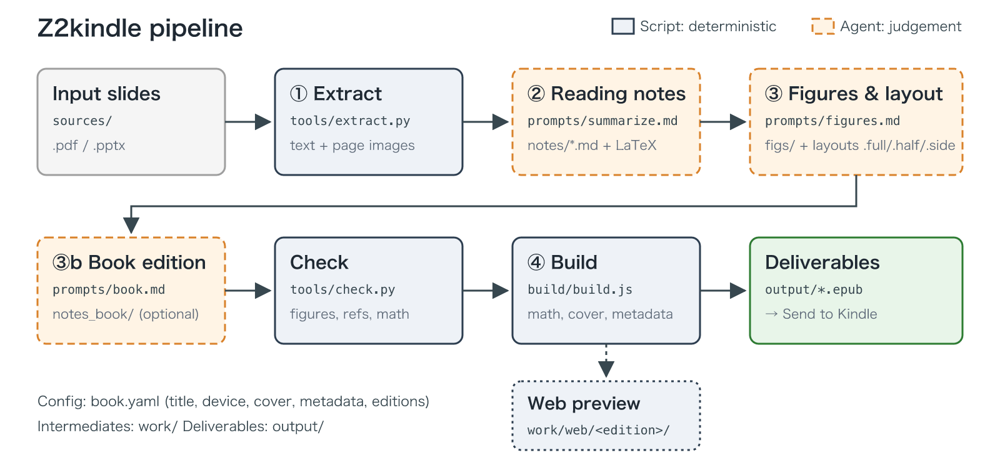
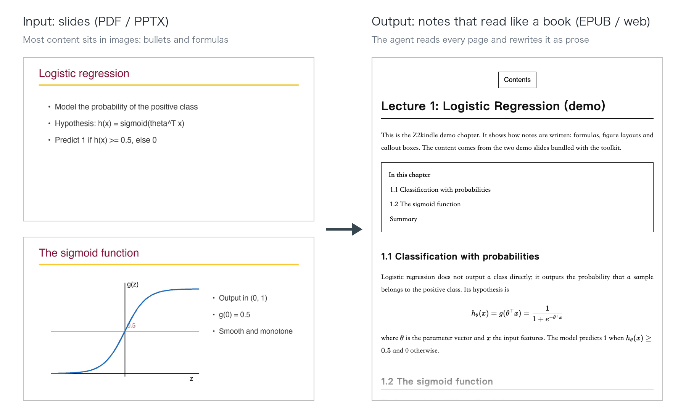
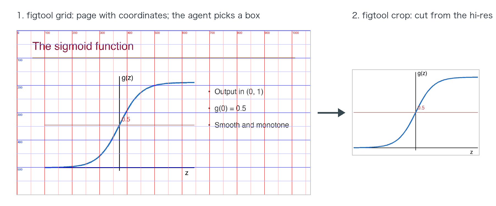
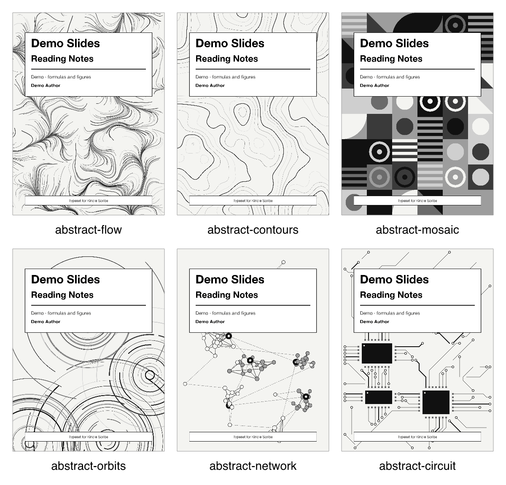

# Z2kindle

English | [简体中文](README.zh-CN.md)

Turn slide decks (PDF / PPTX) into Kindle-friendly reading notes: an EPUB you can read from start to finish. Formulas are fully rendered, and the important slide figures are cropped out and laid into the text. Optionally you also get a "book edition" that reads like a textbook, and a web preview.



The work splits into two kinds:

- **Scripts** do the deterministic steps, with the same result every time: extraction, cropping, checking, building.
- **An agent** (Claude Code, Codex or any coding agent that can read images) does the judgement steps: writing notes, choosing figures and layouts, rewriting. Each step has a ready-made, generic prompt template in `prompts/en/` (English) and `prompts/zh/` (Chinese); requirements specific to one book go in that project's own `prompts/` folder and are appended automatically.

Agents: read [AGENTS.md](AGENTS.md) first.

---

## What it does

Most of the bullets and formulas on slides live inside images. The agent reads every page, rewrites the content as connected prose, transcribes formulas as LaTeX, and picks and lays out the figures that actually help:



The example above uses the demo slides bundled with the toolkit. The right side is the web preview; the EPUB has exactly the same content.

## Languages

The tool and its docs support English and Chinese. **English is the default.**

- **The book's language** is set by `language` in `book.yaml` (default `en`; use `zh-CN` for Chinese). It decides:
  - which prompt set the agent uses (`prompts/en/` or `prompts/zh/`);
  - the interface text in the web preview and the EPUB ("Contents" / "目录", …);
  - which closing sections the book edition must have;
  - whether the traditional-character check runs.
- **New Chinese project**: `python3 -I tools/init.py ~/books/ml-final --language zh-CN`.
- **One book in both languages**: add an edition under `editions:` with its own `language`. The demo project does exactly this.
- **Docs**: English in this file and [AGENTS.md](AGENTS.md); Chinese in [README.zh-CN.md](README.zh-CN.md) and [AGENTS.zh-CN.md](AGENTS.zh-CN.md).

## Quick start

Install first:

- **poppler**, for `pdftotext` and `pdftoppm`.
- **pandoc 2.x**. Tested with 2.16; 3.x works but prints a warning, so check the output.
- **Node 18+** and **Python 3.9+**.

```bash
brew install poppler pandoc        # macOS; use your package manager on Linux
```

```bash
make deps                          # npm install + pip install -r requirements.txt
```

```bash
make demo                          # run the whole pipeline on the two bundled demo slides
```

Afterwards:

- The EPUBs are in `examples/demo/output/`: `demo-notes.epub` (English) and `demo-notes-zh.epub` (Chinese).
- The web previews are at `examples/demo/work/web/main/index.html` (English) and `work/web/zh/index.html` (Chinese).

## Making a new book

### 1. Create a project and add the slides

```bash
python3 -I tools/init.py ~/books/ml-final --title "Machine Learning · Reading Notes" --device scribe-11
```

```bash
cp ~/Downloads/slides/*.pdf ~/books/ml-final/sources/
```

`init.py` creates the fixed folder layout (see [Project layout](#project-layout)) and a commented `book.yaml`. Devices: `scribe-11`, `scribe-10`, `paperwhite-7`, `paperwhite-6.8`, `kindle-6`, `colorsoft-7`.

### 2. Extract text and page images

```bash
make extract P=~/books/ml-final
```

Each page is rendered twice: an 80 dpi preview for the agent to read, and a 220 dpi image for cropping. The text is extracted too. PPTX files are unpacked, with a list of the images each slide uses.

### 3. Let the agent write notes and add figures (the judgement steps)

The simplest way is to tell your agent:

> Use Z2kindle (the toolkit is at `<path to this repo>`) to turn `~/books/ml-final` into Kindle notes. Read `AGENTS.md` first.

Following [AGENTS.md](AGENTS.md), the agent does three steps, running the checks after each one:

1. writes the reading notes (`summarize`);
2. chooses, crops and lays out figures (`figures`);
3. optionally, rewrites the notes as a book edition (`book`).

`tools/prompt.py` prints each step's prompt with all placeholders filled. It picks the English or Chinese template from the book's language:

```bash
python3 -I tools/prompt.py ~/books/ml-final summarize --chapters L1_Intro,L2_Regression
```

**With Claude Code**, you can also install the bundled skill. It groups chapters and hands them to parallel sub-agents automatically:

```bash
ln -s "$PWD/skill/z2kindle" ~/.claude/skills/z2kindle
```

**How figures are made**: the agent views the page with a coordinate grid and chooses a crop box. `figtool` then cuts the figure from the hi-res render and trims the white margins:



Each figure gets one of four layouts:

- `.full`: full text width;
- `.half`: centred, about 64% of the width;
- `.side`: floats right, with the text wrapping around it;
- `.pair`: two figures side by side.

`prompts/en/figures.md` explains when to use each.

### 4. Check and build

```bash
make check P=~/books/ml-final
```

```bash
make build P=~/books/ml-final
```

- **Check** looks at image paths, consecutive figure numbering, an in-text reference to every figure, balanced `:::` and `$$`, bare HTML tags, and (for Chinese books) traditional characters. It exits with code 1 when something fails.
- **Build** writes every edition's EPUB to `output/`. With `web: true` in the config, or `BUILD_ARGS=--web`, it also writes the web preview to `work/web/<edition>/`.

### 5. Send it to your Kindle

Send the EPUB from `output/` with **Send to Kindle** (the web page, email or the desktop app). Copying an EPUB to a Kindle over USB does not work.

## Project layout

Everything for one book lives in one folder, always laid out the same way:

```
<project>/
  book.yaml            the only config: title, device, cover, metadata, editions
  sources/             input: slide decks (.pdf / .pptx)
  notes/               main edition: one Markdown file per source deck (the single source of truth)
  notes_<edition>/     other editions, e.g. notes_book/ or notes_zh/
  figs/<stem>/*.png    cropped figures, shared by all editions
  front/               preface, overview, custom cover image (optional)
  prompts/             project-specific prompt rules (optional), added to the built-in templates
  work/                intermediates, safe to delete and rebuild:
                         text/ img/ hires/ pptx/ grid/ manifest.json   extraction output
                         epub-<edition>/   EPUB build files (formula images, cover, metadata)
                         covers/<edition>/ cover previews
                         web/<edition>/    web preview (only when asked for)
  output/              deliverables: <output_name>.epub, <output_name>-<edition>.epub
```

- **Input** goes only into `sources/`.
- **Only these are edited** by you or the agent: `book.yaml`, `notes*/`, `figs/` and `front/`.
- **Deliverables** appear only in `output/`.
- Everything in `work/` can be regenerated, so you can leave it out when backing up or sharing a project.

## Configuration: book.yaml

```yaml
title: Machine Learning · Reading Notes
subtitle: Decks 1–18
language: en                   # en (default) or zh-CN; picks prompts and interface text
device: scribe-11              # see profiles/devices.yaml
front: front/overview.md       # preface (optional)
output_name: ML_Review         # -> output/ML_Review.epub (default: the folder name)
web: false                     # true = also build the web preview
# chapters: [A1, A2, B01, B02]  # explicit order (needed when deck numbers overlap)
# parts:                       # optional part divider pages
#   - {title: "Part I", first: A1, intro: front/part1.md}
#   - {title: "Part II", first: B01}

metadata:                      # embedded in the EPUB; every field optional
  author: Jane Doe             # or a list
  date: 2026-12-01             # default: the build date
  publisher: ""
  description: One-sentence blurb
  subject: [machine learning, notes]
  rights: For personal use only
  # contributors: [{name: John Roe, role: editor}]
  # series: CS101              # collection name, with series_index
  # identifier: 978-...        # ISBN; omit for a stable generated UUID

cover:
  style: abstract              # plain | figures | abstract
  art: mosaic                  # abstract: flow | contours | mosaic | orbits | network | circuit
  palette: mono                # mono | ink | forest | dusk | [list of colours]
  heading: Machine Learning
  subheading: Reading Notes

editions:                      # more editions: only what differs from the main one
  book:
    title: Machine Learning · Book Edition
    notes: notes_book          # default: notes_<edition name>
    front: front/preface_book.md
    cover: {subheading: Book Edition}
  zh:
    language: zh-CN            # a Chinese edition of the same book
    title: 机器学习 · 阅读笔记
```

### Editions

Every edition under `editions:` shares `sources/` and `figs/`, and overrides only the settings it lists. `cover` and `metadata` are merged field by field.

- `make build` builds every edition; add `E=book` to build just one.
- Check a book edition with `make check P=… E=book CHECK_ARGS="--book --baseline main"`. This also checks:
  - that the closing sections are present: Summary, Key Formulas and Key Terms for English books; 小结, 关键公式 and 术语对照 (substring match) for Chinese books;
  - that no formula or figure from the main edition was lost.

### Book metadata

Everything under `metadata:` is written into the EPUB. You see it in the Kindle's book details, and on the EPUB title page. In addition:

- The author is printed on the cover. To turn that off, add `show_author: false` under `cover:`.
- The web preview's contents page shows "author · publisher · date" under the title.
- **The identifier** is generated from the project and the edition, and stays the same across builds. When you rebuild and resend a book, the Kindle treats it as the same book.

### Cover

The cover is sized to the device screen, in one of three styles:

| Style | Result |
|---|---|
| `plain` (default) | Black-on-white title page with the chapter list; long lists switch to two columns |
| `figures` | Title plus a collage of slide figures. `figures: auto` picks one figure from each chapter; or give a list of image paths. `count: 1–9` sets how many |
| `abstract` | Generative art under a title card. `art` picks the pattern, `palette` the colours, and a different `seed` number gives a new variation |

Render every style first, then choose:

```bash
make covers P=~/books/ml-final     # writes work/covers/<edition>/; contact.png compares them
```



To use your own image, set `cover.image: front/cover.png`. It overrides everything else.

### Devices

`profiles/devices.yaml` defines these parameters for each device:

- **screen resolution**: sets the cover size;
- **formula pixel density** `px_per_em`: sets how sharp formula images are;
- **maximum figure width** `figure_max_width`: cropped figures wider than this are scaled down;
- **colour**: sets the default cover palette.

The Kindle reflows the text itself (font, size and line spacing come from the reader's settings), so the same content works on every Kindle. The only thing that really has to change between devices is the cover size, and changing `device:` handles that. To support a new device, add an entry to the file.

## Note format

One Markdown file per source deck, e.g. `notes/L3_Generalization.md`:

````markdown
# L3 · Model Generalization

> **Overview:** One paragraph stating the chapter's central question and conclusions.

## 1. Underfitting and overfitting

Body text… inline math $h_\theta(x)$, display math in its own paragraph:

$$
J(\theta) = \frac{1}{2}\sum_{i=1}^{n}\left(h_\theta(x^{(i)}) - y^{(i)}\right)^2
$$

Figure 3-1 compares the three fits.

::: {.fig .full}

:::
````

- **Formulas**: use only commands KaTeX supports. The web preview pre-renders them with KaTeX, so no JavaScript is needed. In the EPUB each formula becomes an image sized in em, because Kindle's MathML support is unreliable.
- **Figures**: a fenced div wraps a paragraph that contains only the image; the image's alt text is the caption. Figures are numbered per chapter and must be referenced in the text.
- **Callout boxes** (mostly in the book edition): `::: {.aside}` is an "Extension" box for material beyond the slides; `::: {.note}` is a "Note" box for typos or unclear points in the slides.
- **Angle-bracket tokens** such as `<s>` must go in backticks, otherwise they are parsed as HTML tags.

## Command reference

Run every command from the repository root. `P=` is the project folder; `E=` is an optional edition name.

| Command | What it does |
|---|---|
| `make deps` | install Node and Python dependencies |
| `python3 -I tools/init.py <project> --title T --device D [--language zh-CN]` | create a project (English by default) |
| `make extract P=…` | extract text and page images into `work/` |
| `python3 -I tools/prompt.py <project> summarize\|figures\|book --chapters …` | print a stage's prompt with placeholders filled, in the book's language |
| `python3 -I tools/figtool.py <project> grid <stem> <page>` | page image with a coordinate grid |
| `python3 -I tools/figtool.py <project> crop <stem> <page> x0 y0 x1 y1 <name>` | crop by preview coordinates into `figs/<stem>/` |
| `make check P=… [E=…]` | check the notes |
| `make build P=… [E=…]` | build EPUBs into `output/` (`BUILD_ARGS=--web` adds the web preview) |
| `make covers P=… [E=…]` | render every cover style for comparison |
| `make demo` / `make clean-demo` | run the demo / remove its generated files |

## Repository layout

```
AGENTS.md            operating manual for AI agents (Chinese: AGENTS.zh-CN.md)
tools/               Python: init, extract, figtool, check, prompt, z2k_project (config)
build/               Node: build (entry point), build_epub, build_web, cover, lib, styles/
prompts/en, zh/      prompt templates for the judgement steps: summarize, figures, book, draft, review
profiles/            device parameters, devices.yaml
skill/z2kindle/      Claude Code skill
examples/demo/       demo project: English main edition + Chinese edition (slides generated by a script; no real course content)
docs/images/         README images in both languages (regenerate with src/make_images.py)
```

## Caveats

- **Cost**: writing notes, adding figures and the book edition each read every slide image. As a rough guide, each step uses about 150–200k agent tokens per 15–20 slide pages. In one real run, 18 decks (about 320 pages) took about three million tokens for all three steps. Estimate time and cost before processing a large batch.
- **Copyright**: the slides, and the notes generated from them, belong to their author. Do not commit them to a public repository. The toolkit itself is what you can share.
- **Human review**: the agent can make mistakes. `check.py` only checks structure; whether the content is correct needs a human. Check the final EPUB on a real device.
- **PPTX limits**: diagrams drawn with PowerPoint shapes (rather than image files) cannot be cropped.

## License

MIT (see `LICENSE`). Dependency licenses: KaTeX (MIT), MathJax (Apache-2.0), resvg-js (MPL-2.0), Pandoc (GPL, called as an external program), poppler (GPL, called as an external program).
