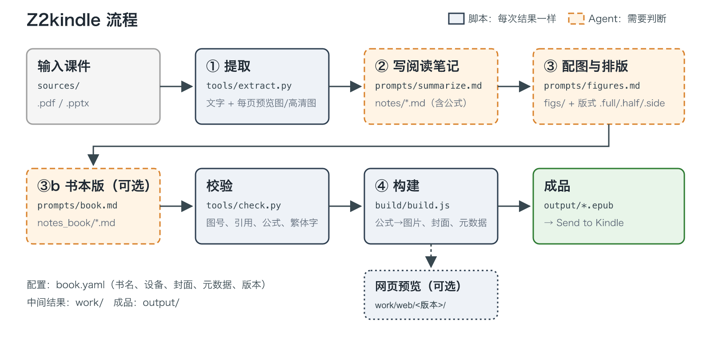
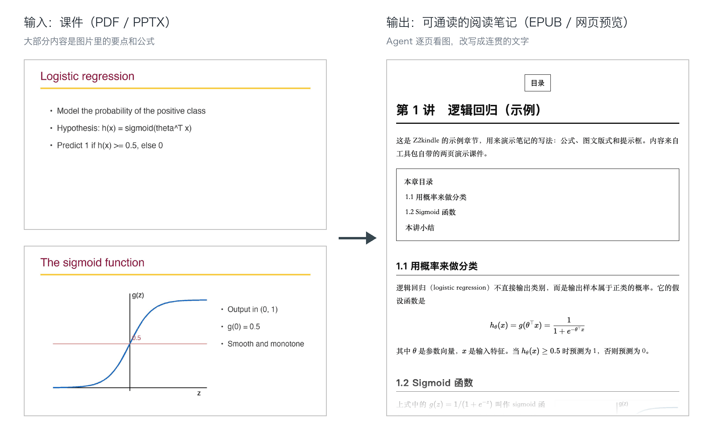
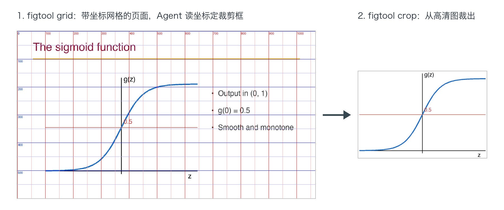
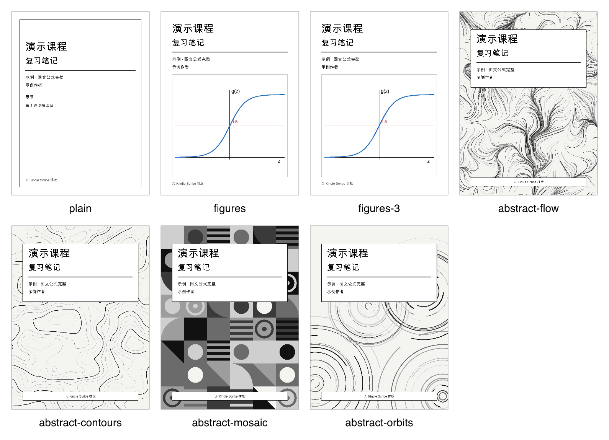

# Z2kindle

[English](README.md) | 简体中文

把课件（PDF / PPTX）变成适合 Kindle 阅读的复习笔记：一本可以从头读到尾的 EPUB 电子书。公式完整渲染，课件里的重点图会被裁出来，按版式排进正文。还可以再出一个读起来像教材的"书本版"，以及一份网页预览。



流程分成两类工作：

- **脚本**负责固定步骤，每次结果都一样：提取、裁图、校验、构建。
- **Agent**（Claude Code、Codex 等能看图的编程 Agent）负责需要判断的步骤：写笔记、挑图、选版式、改写。每一步都有一份写好的提示词模板，放在 `prompts/en/`（英文）和 `prompts/zh/`（中文）里。

---

## 效果

课件里大部分要点和公式都在图片里。Agent 会逐页看图，把内容改写成连贯的中文讲解，公式转写成 LaTeX，挑出真正有用的图并安排版式：



上图用的是工具自带的示例课件。右边是网页预览，EPUB 的内容与它完全一样。

## 语言

工具和文档都支持中英文，**默认英文**：

- **书的语言**由 `book.yaml` 里的 `language` 决定，默认 `en`；中文书写 `zh-CN`。它决定 Agent 用哪套提示词（`prompts/en/` 或 `prompts/zh/`）、网页和 EPUB 界面文字（"Contents"/"目录"等）、书本版必须有的章末小节名，以及是否检查繁体字。
- **新建中文项目**：`python3 -I tools/init.py ~/books/ml-final --language zh-CN`。
- **同一本书出中英两版**：在 `editions:` 里加一个版本并单独设置 `language`，示例项目就是这样做的。
- **文档**：英文版是 [README.md](README.md) 和 [AGENTS.md](AGENTS.md)，中文版是本文件和 [AGENTS.zh-CN.md](AGENTS.zh-CN.md)。

## 快速开始

需要先装好：

- **poppler**：提供 `pdftotext` 和 `pdftoppm`。
- **pandoc 2.x**：用 2.16 测试过；3.x 能用，但会给出警告，需要检查输出。
- **Node 18+** 和 **Python 3.9+**。

```bash
brew install poppler pandoc        # macOS；Linux 用对应的包管理器
```

```bash
make deps                          # npm install + pip install -r requirements.txt
```

```bash
make demo                          # 用自带的两页示例课件跑一遍完整流程
```

跑完以后：

- 电子书在 `examples/demo/output/`：`demo-notes.epub` 是英文版，`demo-notes-zh.epub` 是中文版。
- 网页预览在 `examples/demo/work/web/main/index.html`（英文）和 `work/web/zh/index.html`（中文）。

## 做一本新书

### 1. 新建项目，放入课件

```bash
python3 -I tools/init.py ~/books/ml-final --title "机器学习 · 复习笔记" --device scribe-11 --language zh-CN
```

```bash
cp ~/Downloads/lectures/*.pdf ~/books/ml-final/sources/
```

`init.py` 会建好固定的目录结构（见[项目结构](#项目结构)），并生成一份带注释的 `book.yaml`。设备可选 `scribe-11`、`scribe-10`、`paperwhite-7`、`paperwhite-6.8`、`kindle-6`、`colorsoft-7`。

### 2. 提取文字和页面图

```bash
make extract P=~/books/ml-final
```

这一步会把每页渲染成 80 dpi 的预览图（给 Agent 看）和 220 dpi 的高清图（裁图用），同时提取文字。PPTX 会被解包，并列出每页用到的图片。

### 3. 让 Agent 写笔记、配图（需要判断的步骤）

最省事的做法是直接告诉 Agent：

> 用 Z2kindle（工具在 `<本仓库路径>`）把 `~/books/ml-final` 做成 Kindle 笔记。先读 `AGENTS.md`。

Agent 会按 [AGENTS.md](AGENTS.md) 依次完成：写阅读笔记（`summarize`）→ 选图、裁图、排版（`figures`）→ 可选的书本版改写（`book`），每一步之后都会跑校验。每一步的提示词可以用 `tools/prompt.py` 自动填好，它会按书的语言选择中文或英文模板：

```bash
python3 -I tools/prompt.py ~/books/ml-final summarize --chapters L1_Intro,L2_Regression
```

**用 Claude Code 的话**，还可以装上自带的 skill，它会自动把章节分组，派给多个子任务并行处理：

```bash
ln -s "$PWD/skill/z2kindle" ~/.claude/skills/z2kindle
```

**配图是怎么做的**：Agent 先看带坐标网格的页面，确定裁剪框；`figtool` 再从高清图上裁出来，自动去掉白边：



每张图有四种版式可选：整行宽 `.full`、居中半宽 `.half`、右侧环绕 `.side`、两图并排 `.pair`。具体怎么选，写在 `prompts/zh/figures.md`（英文版 `prompts/en/figures.md`）里。

### 4. 校验、构建

```bash
make check P=~/books/ml-final
```

```bash
make build P=~/books/ml-final
```

- **校验**：检查图片路径、图号是否连续、正文是否引用了每张图、`:::` 和 `$$` 是否配对、有没有裸露的 HTML 标签、有没有繁体字。有问题时退出码为 1。
- **构建**：生成所有版本的 EPUB，放到 `output/`。如果配置里写了 `web: true`，或者构建时加 `BUILD_ARGS=--web`，还会把网页预览生成到 `work/web/<版本>/`。

### 5. 发到 Kindle

用 **Send to Kindle**（网页、邮件或桌面应用都可以）发送 `output/` 里的 EPUB。直接用 USB 把 EPUB 拷进 Kindle 是不行的。

## 项目结构

一本书的所有东西都放在同一个文件夹里，结构固定：

```
<project>/
  book.yaml            唯一的配置：书名、设备、封面、元数据，以及各个版本
  sources/             输入：课件 .pdf / .pptx
  notes/               主版本的章节 Markdown，每章一个文件（唯一源文件）
  notes_<版本>/        其他版本的章节，例如 notes_book/
  figs/<stem>/*.png    裁好的图，各版本共用
  front/               前言、Overview、自定义封面图（可选）
  work/                中间结果，随时可以删掉重建
                         text/ img/ hires/ pptx/ grid/ manifest.json   提取结果
                         epub-<版本>/   EPUB 构建文件（公式图片、封面、元数据）
                         covers/<版本>/ 封面预览
                         web/<版本>/    网页预览（只在要求时生成）
  output/              最终成品：<output_name>.epub、<output_name>-<版本>.epub
```

- **输入**只放在 `sources/`。
- **需要人或 Agent 编辑的**只有 `book.yaml`、`notes*/`、`figs/`、`front/`。
- **成品**只出现在 `output/`。
- `work/` 里的内容都能重新生成，备份或分享项目时可以不带。

## 配置：book.yaml

```yaml
title: 机器学习 · 复习笔记
subtitle: L1–L18 课件阅读版
language: zh-CN                # 默认 en；决定提示词模板和界面文字
device: scribe-11              # 见 profiles/devices.yaml
front: front/overview.md       # 前言（可选）
output_name: ML_Review         # -> output/ML_Review.epub（默认用文件夹名）
web: false                     # true = 同时生成网页预览

metadata:                      # 写进 EPUB 的书籍信息，全部可选
  author: 张三                 # 也可以是列表
  date: 2026-12-01             # 不写就用构建当天的日期
  publisher: ""
  description: 一句话简介
  subject: [机器学习, 复习]
  rights: 仅供个人学习使用
  # contributors: [{name: 李四, role: editor}]
  # series: CSE475             # 丛书名，配合 series_index
  # identifier: 978-...        # ISBN；不写就生成固定的 UUID

cover:
  style: abstract              # plain | figures | abstract
  art: mosaic                  # abstract：flow | contours | mosaic | orbits | network
  palette: mono                # mono | ink | forest | dusk | [色值列表]
  heading: 机器学习
  subheading: 复习笔记

editions:                      # 其他版本：只写和主版本不同的设置
  book:
    title: 机器学习 · 书本版
    notes: notes_book          # 默认就是 notes_<版本名>
    front: front/preface_book.md
    cover: {subheading: 书本版}
```

### 多个版本

`editions:` 下的每个版本共用 `sources/` 和 `figs/`，只覆盖自己写出的设置（`cover` 和 `metadata` 按字段合并）。

- `make build` 会构建全部版本；只构建一个版本时加 `E=book`。
- 校验书本版：`make check P=… E=book CHECK_ARGS="--book --baseline main"`。这会额外检查章末小节是否齐全（中文书是本讲小结、关键公式、术语对照；英文书是 Summary、Key Formulas、Key Terms），以及主版本里的公式和图有没有丢。
- 版本可以有自己的 `language`，用来做中英两个版本。

### 书籍元数据

`metadata:` 里的信息会写进 EPUB，在 Kindle 的书籍详情里能看到，也会出现在 EPUB 扉页上。另外：

- 作者会印在封面上。不想印的话，在 `cover:` 里写 `show_author: false`。
- 网页预览的目录页会在书名下显示"作者 · 出版社 · 日期"。
- **标识符**默认按项目和版本生成，并且固定不变：同一本书重新构建、重新发送，Kindle 会把它当成同一本书。

### 封面

封面按设备屏幕尺寸生成，共有三种样式：

| 样式 | 效果 |
|---|---|
| `plain`（默认） | 白底黑字标题页，附章节目录；章节多时自动分两栏 |
| `figures` | 标题加一组课件配图拼贴。`figures: auto` 会从各章自动挑图，也可以写成图片路径列表；`count: 1–9` 控制张数 |
| `abstract` | 生成式抽象图案，上面压一张标题卡片。图案用 `art` 选，配色用 `palette` 选，换一个 `seed` 数字就换一种变化 |

先把所有样式都渲染出来比较一下，再决定用哪个：

```bash
make covers P=~/books/ml-final     # 输出到 work/covers/<版本>/，contact.png 是对比总览
```



想用自己的图片做封面，就写 `cover.image: front/cover.png`，它的优先级最高。

### 设备

`profiles/devices.yaml` 为每种设备定义了以下参数：

- **屏幕分辨率**：决定封面的尺寸。
- **公式像素密度** `px_per_em`：决定公式图片的清晰度。
- **配图最大宽度** `figure_max_width`：裁出来的图超过这个宽度会被缩小。
- **是否彩色**：决定封面的默认配色。

正文由 Kindle 自己重排（字体、字号、行距都由阅读设置决定），所以同一份内容对所有 Kindle 都通用。换设备时，真正需要改的只有封面尺寸，改 `device:` 就会自动处理。要支持新设备，在这个文件里加一项即可。

## 笔记格式

每章一个 Markdown 文件，例如 `notes/L3_Generalization.md`：

````markdown
# L3 · 模型泛化（Model Generalization）

> **Overview：** 一段话点明本章核心论题与结论。

## 1. 欠拟合与过拟合

正文……行内公式 $h_\theta(x)$，独立公式单独成段：

$$
J(\theta) = \frac{1}{2}\sum_{i=1}^{n}\left(h_\theta(x^{(i)}) - y^{(i)}\right)^2
$$

三种拟合的对比见图 3-1。

::: {.fig .full}

:::
````

- **公式**：只用 KaTeX 支持的命令。网页预览用 KaTeX 预先渲染，不需要 JavaScript。EPUB 里每个公式会转成按 em 定尺寸的图片，因为 Kindle 对 MathML 的支持不可靠。
- **图**：用 fenced div 包住只含图片的段落，图片的 alt 文字就是图注。图号按章编号，并且要在正文里引用。
- **提示框**（书本版常用）：`::: {.aside}` 是"延伸"框，放超出课件范围的补充；`::: {.note}` 是"注意"框，放课件里的笔误或存疑之处。
- **尖括号记号**（比如 `<s>`）要放进反引号，否则会被当成 HTML 标签。

## 命令速查

所有命令都在本仓库根目录运行。`P=` 是项目文件夹，`E=` 是版本名（可选）。

| 命令 | 作用 |
|---|---|
| `make deps` | 安装 Node 和 Python 依赖 |
| `python3 -I tools/init.py <project> --title T --device D [--language zh-CN]` | 新建项目（默认英文） |
| `python3 -I tools/prompt.py <project> summarize\|figures\|book --chapters …` | 输出填好占位符的提示词，按书的语言选模板 |
| `make extract P=…` | 提取文字和页面图到 `work/` |
| `python3 -I tools/figtool.py <project> grid <stem> <页码>` | 生成带坐标网格的页面图 |
| `python3 -I tools/figtool.py <project> crop <stem> <页码> x0 y0 x1 y1 <名字>` | 按预览图坐标裁图，保存到 `figs/<stem>/` |
| `make check P=… [E=…]` | 校验笔记 |
| `make build P=… [E=…]` | 构建 EPUB 到 `output/`（`BUILD_ARGS=--web` 同时生成网页预览） |
| `make covers P=… [E=…]` | 渲染全部封面样式用来比较 |
| `make demo` / `make clean-demo` | 跑示例 / 清理示例生成的文件 |

## 仓库结构

```
AGENTS.md            给 AI Agent 的完整操作手册（中文版 AGENTS.zh-CN.md）
tools/               Python：init、extract、figtool、check、prompt、z2k_project（读取配置）
build/               Node：build（总入口）、build_epub、build_web、cover、lib、styles/
prompts/en, zh/      需要判断的步骤所用的提示词模板：summarize、figures、book
profiles/            设备参数 devices.yaml
skill/z2kindle/      Claude Code skill
examples/demo/       示例项目：英文主版本 + 中文版本（课件由脚本现场生成，不含任何真实课程内容）
docs/images/         README 用图，中英各一套（src/make_images.py 可重新生成）
```

## 注意事项

- **成本**：写笔记、配图、书本版这三步都要逐页看图。粗略估计，每 15–20 页课件每一步约用 15–20 万 Agent token；一次实际使用中，18 讲约 320 页课件三步合计用了约三百万 token。处理大批课件前，先估一下时间和费用。
- **版权**：课件和由它生成的笔记属于原作者，不要提交到公开仓库。可以分享的是工具本身。
- **人工复核**：Agent 写出来的内容可能有误。`check.py` 只检查结构问题，内容是否准确需要人来看。EPUB 最终的效果要在真机上确认。
- **PPTX 的限制**：PPT 里用形状拼出来的图（不是图片文件）没法裁剪。

## 许可证

MIT（见 `LICENSE`）。依赖的许可证：KaTeX（MIT）、MathJax（Apache-2.0）、resvg-js（MPL-2.0）、Pandoc（GPL，作为外部命令调用）、poppler（GPL，作为外部命令调用）。
